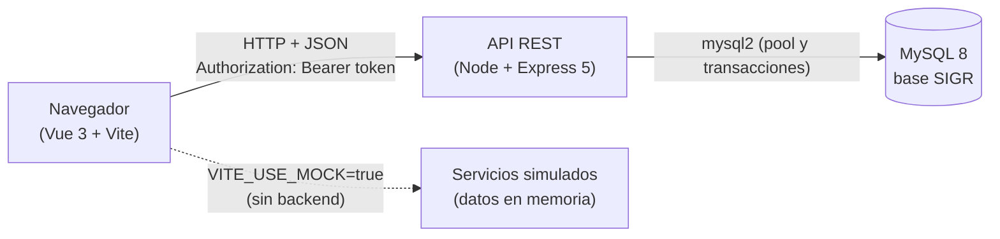
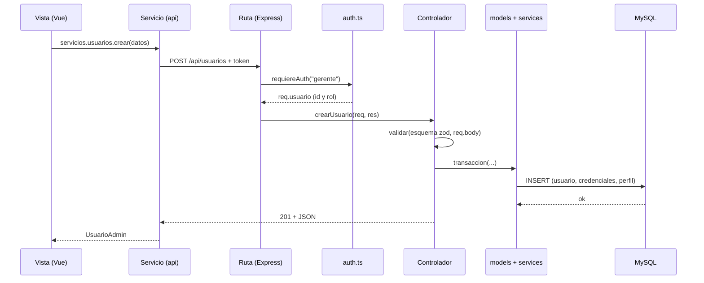

# Arquitectura de SIGR

Aplicación web de tres capas: **frontend** (Vue), **backend** (API REST con Node y Express) y **base de datos** (MySQL). Este documento explica cómo se conectan y por qué el código está organizado así.

## 1. Vista general

- Con `VITE_USE_MOCK=true` el frontend usa servicios simulados y **no necesita backend ni base de datos**.
- Con `VITE_USE_MOCK=false` llama a la API real. Las pantallas no cambian: dependen de las mismas interfaces.

## 2. Qué hace cada carpeta

### Backend (`backend/src/`)

| Carpeta o archivo | Responsabilidad |
| --- | --- |
| `index.ts` | Punto de entrada: crea la app de Express, activa CORS y JSON, monta las rutas y el manejo de errores. |
| `routes/` | **Endpoints.** Cada archivo solo dice «esta ruta, con este permiso, la atiende este controlador». |
| `controllers/` | **Lógica de negocio.** Valida la entrada, aplica las reglas, consulta la base y arma la respuesta. |
| `models/` | **Modelos de datos.** Los DTO (la forma exacta del JSON), las consultas compartidas, los estados del pedido y las reglas de existencia (`dominio.ts`). |
| `services/` | **Conexión y servicios de infraestructura:** pool y transacciones (`db.ts`), idempotencia (`idempotencia.ts`), transporte unificado de correo Resend/SMTP (`correo.ts`), plantillas HTML y de texto de las reservaciones (`plantillasCorreo.ts`) y cola de confirmaciones, recordatorios, vencimientos y cancelaciones (`notificacionesReservacion.ts`). |
| `utils/` | Funciones auxiliares: configuración (`config.ts`), errores uniformes (`errores.ts`), autenticación y permisos por rol (`auth.ts`) y el script de usuarios de prueba (`seed.ts`). |
| `mocks/` | Datos falsos tipados para probar la API sin tocar la base real. |
| `../tests/` | Pruebas unitarias (Vitest). |

### Frontend (`frontend/`)

| Carpeta o archivo | Responsabilidad |
| --- | --- |
| `index.html`, `main.ts`, `vite.config.ts` | Arranque de la aplicación y configuración de Vite. |
| `src/views/` | Páginas principales, agrupadas por rol (`mesero/`, `hostess/`, `gerente/`). |
| `src/components/` | Componentes reutilizables (diálogos, formularios, insignias). |
| `src/router/` | Rutas y guardas por rol. |
| `src/services/` | Llamadas a la API (`api/`), servicios simulados (`mock/`) e interfaces comunes (`interfaces.ts`). |
| `src/stores/` | Estado global con Pinia. |
| `src/mocks/` | Datos falsos en JSON (`clientes.json`, `productos.json`) que alimentan los servicios simulados. |
| `src/utils/` | Funciones auxiliares (carrito, reglas de negocio, formato, contraste). |
| `src/assets/`, `public/` | Imágenes, íconos y archivos estáticos. |
| Carpetas adicionales | `src/types/` (modelos y estados), `src/layouts/` (estructura de cada rol), `src/composables/` (lógica reutilizable de Vue) y `src/styles/` (tokens de diseño y estilos base). |

### Correo de reservaciones

Las confirmaciones y cancelaciones se insertan en `notificacion_reservacion` dentro de la misma transacción que crea, confirma o cancela la reservación. Después del commit se solicita el procesamiento sin esperar al proveedor; el ciclo periódico también recoge cualquier aviso pendiente. El mismo procesador entrega confirmaciones, recordatorios, vencimientos y cancelaciones por `enviarCorreo`, que selecciona Resend o SMTP. La columna `evento` diferencia `creada` y `confirmada`; el índice único compuesto deduplica cada evento. Fallos se guardan en la fila y se reintentan; el límite diario de Gmail (`550 5.4.5`) espera seis horas.

El contenido se arma en `plantillasCorreo.ts`: cada plantilla devuelve `asunto`, `texto` y `html`. El HTML es una tarjeta editorial de hasta 600 px con marco agave, papel cálido y un acento por tipo de aviso, construida con tablas y estilos en línea, sin imágenes. El texto plano viaja como alternativa y el diseño no altera la cola ni las reglas de negocio.

### Base de datos (`database/`)

| Archivo | Responsabilidad |
| --- | --- |
| `docker-compose.yml` | Levanta MySQL 8 en un contenedor. |
| `init.sql` | Script inicial: crea la base `SIGR` con sus 23 tablas, los catálogos y los datos base. |
| `migrations/` | Cambios incrementales (`001` a `012`) para bases que ya existían. |
| `seed_demo.sql` | Datos de demostración opcionales (mesas 7 a 18, cuentas, clientes, reservaciones, lista de espera). |

## 3. Cómo viaja una petición

## 4. Decisiones de diseño

| Decisión | Por qué |
| --- | --- |
| **El JSON usa los nombres exactos de las columnas** (snake_case). | Una sola fuente de verdad (`database/init.sql`) y menos traducciones. Lo calculado se marca en `docs/equivalencias-bd.md`. |
| **El servidor calcula precios, totales y disponibilidad.** | El cliente nunca manda precios; así no se puede manipular el cobro. |
| **Transacciones y bloqueo de filas (`FOR UPDATE`)** en las acciones críticas. | Dos meseros no pueden vender la última existencia ni dejar un pedido a medias. |
| **Idempotencia** (`Idempotency-Key`). | Un reintento por mala señal no duplica pedidos ni pagos. |
| **Los usuarios y productos no se borran, se desactivan.** | Tienen pedidos y ventas ligados; borrarlos rompería el historial. |
| **Permisos en el servidor** (`requiereAuth(...roles)`), no solo en el frontend. | Es la única protección real; las guardas del router solo mejoran la experiencia. |
| **Contraseñas con `bcryptjs`; sesión con JWT de 8 horas.** | Nunca se guarda la contraseña en texto; el token no necesita estado en el servidor. |
| **Frontend con dos implementaciones de los servicios** (mock y API). | Se puede trabajar y presentar sin base de datos y se cambia con una variable de entorno. |
| **Errores en un solo formato** `{ codigo, mensaje }`. | El frontend decide el mensaje según el código. |

## 5. Pruebas

| Dónde | Comando | Qué cubre |
| --- | --- | --- |
| `backend/` | `npm test` | Funciones puras del dominio (estados, validación, ids de ruta), datos de los mocks, transporte y plantillas de correo, y cola de notificaciones. |
| `frontend/` | `npm test` | Conversión de datos, servicios simulados, reglas de negocio, stores y utilidades. |
| `frontend/` | `npm run check` | Tipos, pruebas y build; debe pasar antes de entregar. |

Aún no hay pruebas de las rutas contra una base de datos real (ver `docs/PENDIENTES_Y_FALTANTES.md`).

## 6. Despliegue en desarrollo

1. Base de datos: `docker compose -f database/docker-compose.yml up -d` (o MySQL local con `database/init.sql`).
2. Backend: `cd backend && npm install && npm run dev` (puerto 3000).
3. Frontend: `cd frontend && npm install && npm run dev` (puerto 5173).

El detalle de variables de entorno y comandos está en el `README.md`.
