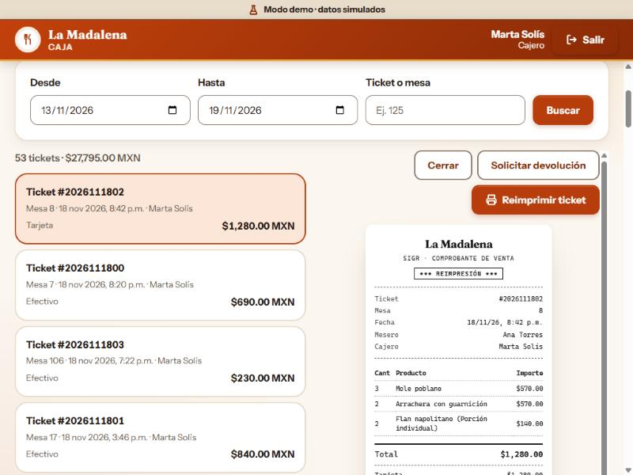
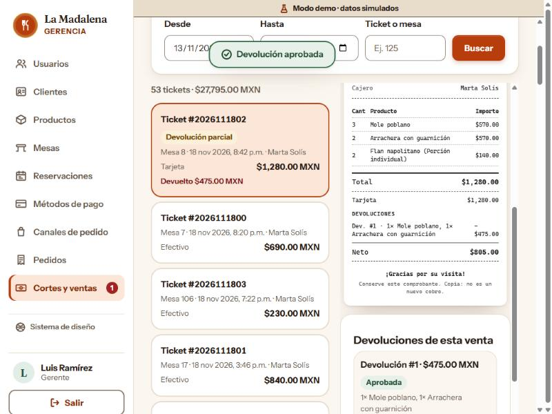
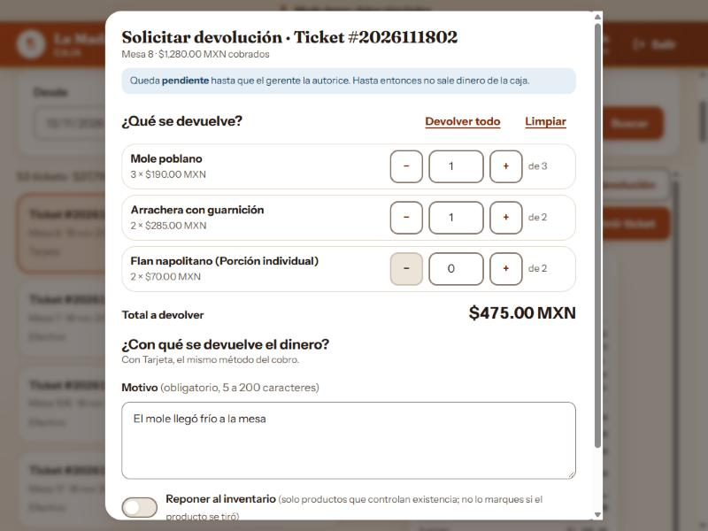
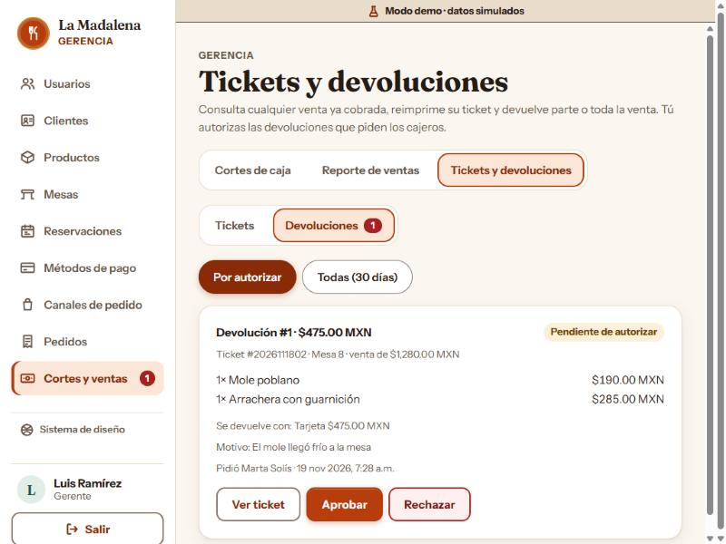
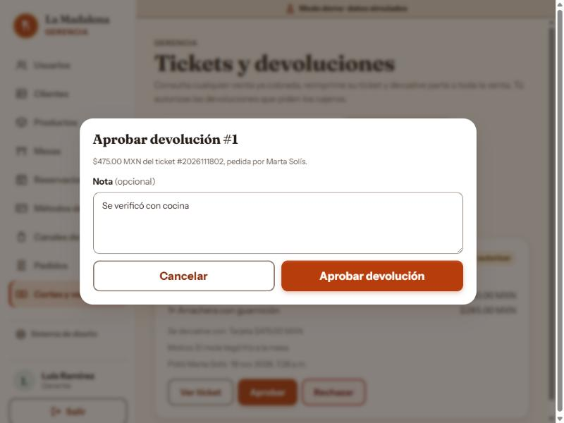
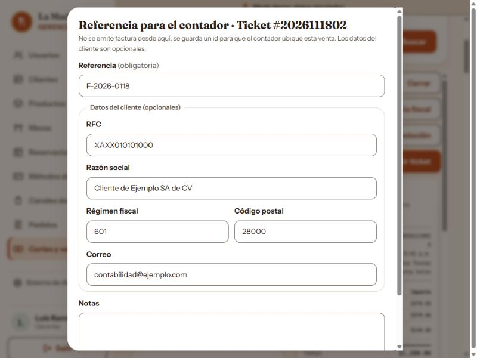

# Pantallas de Caja: tickets pasados y devoluciones

Documenta la pantalla **Tickets y devoluciones**, que usan el **cajero** (`/cajero/tickets`) y el **gerente** (`/gerente/tickets`,
como pestaña de «Cortes y ventas»). El cobro, el corte y el reporte de ventas se explican en
[`guia-codigo/caja_frontend_backend.md`](guia-codigo/caja_frontend_backend.md) y en
[`pantallas-gerente.md`](pantallas-gerente.md#reporte-de-ventas-rf-ven-003-y-rf-ven-004). Las capturas están en
[`capturas/`](capturas/) (modo demo: `npm run dev:demo`, usuarios `cajero` y `gerente`, contraseña `1234`). El contrato de la API
está en [`contrato-api-caja.md`](contrato-api-caja.md). Requisitos: RF-VEN-003, RF-VEN-005, RF-VEN-006 y RF-VEN-007 del
[README](../README.md#requerimientos).

## Qué se puede hacer

| Quién | Acción |
|---|---|
| Cajero y gerente | Buscar ventas ya cobradas por **fecha** (por omisión, los últimos 7 días; máximo 92 días) o por **número de ticket o de mesa**; abrir el ticket; **reimprimirlo** |
| Cajero | **Solicitar** una devolución de un ticket; ver el estado de las que pidió |
| Gerente | **Autorizar o rechazar** las solicitudes de los cajeros; **registrar** una devolución ya aprobada; guardar la **referencia para el contador** de una venta |

## Tickets

- La lista trae el total, los métodos de pago, el cajero y una etiqueta si la venta tiene devoluciones («Devolución parcial»,
  «Devuelta por completo», «N por autorizar») y cuánto se devolvió.
- El ticket tiene el formato de 80 mm del cobro y siempre lleva la marca **REIMPRESIÓN** (es una copia). Cada vez que se pulsa
  «Reimprimir ticket» se guarda **quién y cuándo** (`venta_reimpresion`) y la pantalla muestra cuántas veces se ha reimpreso.
- Si la venta tiene devoluciones aprobadas, el ticket las lista y muestra el **neto**.

## Devoluciones

1. **Qué se devuelve:** producto por producto y por cantidad («Devolver todo» y «Limpiar» ayudan). Lo ya devuelto, o apartado por
   otra solicitud pendiente, no se puede pedir otra vez.
2. **Con qué se devuelve el dinero:** con los **métodos que se usaron al cobrar**, sin pasar de lo cobrado con cada uno (menos lo ya
   devuelto). Si la venta se pagó con un solo método, es ese; si se pagó con varios, la pantalla reparte el importe y se puede
   ajustar («Repartir automático»).
3. **Motivo** obligatorio (5 a 200 caracteres) y, si se quiere, **reponer al inventario** (solo los productos que controlan
   existencia; no se marca si el producto se tiró).

Reglas:

- El **cajero solicita**: la devolución queda **pendiente** y no mueve dinero. El gerente la **aprueba** (con nota opcional) o la
  **rechaza** (la nota es obligatoria y la ve el cajero).
- Al **aprobar**, el efectivo devuelto **sale del corte abierto del cajero que la pidió** y baja el efectivo esperado; si ese
  cajero no tiene la caja iniciada y la devolución incluye efectivo, no se puede aprobar (se pide que inicie caja o se cambia el
  método). Las devoluciones con tarjeta o transferencia no dependen de la caja. Si se pidió reponer, se suma el inventario.
- Si la registra el **gerente**, queda aprobada al momento y no pasa por la caja de nadie.
- Dos solicitudes simultáneas de la misma venta no pueden pasarse de lo vendido ni de lo cobrado (la API bloquea la venta mientras
  decide). Reintentar con la misma `Idempotency-Key` no duplica nada.
- Todo queda en la bitácora de auditoría (`devolucion`, `devolucion_linea`, `devolucion_pago`, `venta_fiscal`).

La pestaña **Devoluciones** lista las solicitudes («Por autorizar» o «Todas», 30 días). El gerente ve un **aviso con el número de
solicitudes pendientes** en «Cortes y ventas» del menú (se actualiza cada 20 s) y aprueba o rechaza desde la tarjeta.

## Referencia para el contador (sin factura)

El sistema **no emite factura**. El gerente guarda en cada venta un **id de referencia** para que el contador la ubique y, si el
cliente lo pidió, sus datos fiscales: RFC, razón social, régimen, código postal y correo (**todos opcionales**; solo la referencia
es obligatoria). El cajero no ve ni guarda estos datos.

## Efecto en el corte y en el reporte de ventas

- **Corte de caja:** el detalle muestra «− Devoluciones» y el **neto**, y el cuadre de efectivo descuenta lo devuelto en efectivo
  (`fondo + cobrado en efectivo − devuelto en efectivo = esperado`). En el historial de cortes se indica cuánto se devolvió.
- **Reporte de ventas:** el total vendido **no** descuenta devoluciones; un aviso bajo el resumen muestra cuántas se aprobaron en el
  periodo (por la fecha en que se aprobaron), su importe y el **neto**. El Excel agrega esas tres filas al resumen.
- **Inventario y mermas:** una devolución sin «reponer» cuenta como producto perdido en el reporte de **Mermas**, aparte del valor
  de las mermas registradas.

## En modo demo

Las ventas de días anteriores son las de ejemplo del reporte (siempre las mismas para el mismo día); las que se cobran en la
sesión también aparecen. Las devoluciones, reimpresiones y referencias se guardan en memoria y se pierden al recargar. El
cajero y el gerente comparten esa memoria: cierra sesión y entra como gerente (sin recargar la página) para autorizar.

Código: `frontend/src/views/cajero/TicketsView.vue`, `components/DevolucionDialog.vue`, `components/TicketVenta.vue`,
`components/ReferenciaFiscalDialog.vue`, `utils/devoluciones.ts` (reglas compartidas con la demo), `services/api/caja.ts` y
`services/mock/ticketsMock.ts`; backend `controllers/ventas.ts` y `models/devolucion.ts`.
