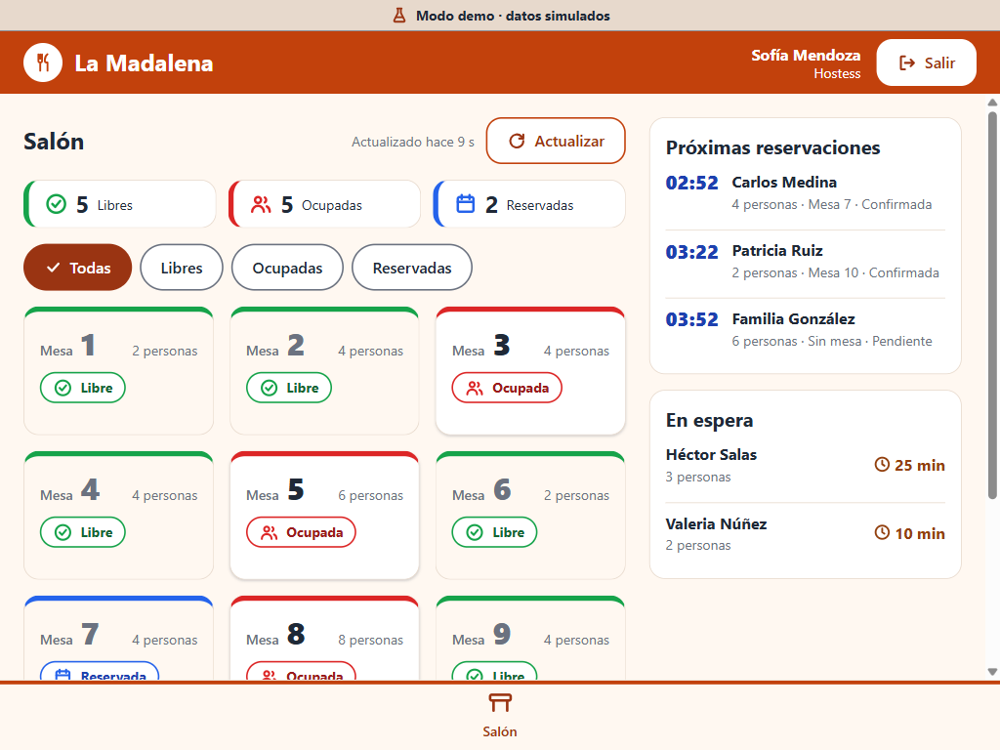
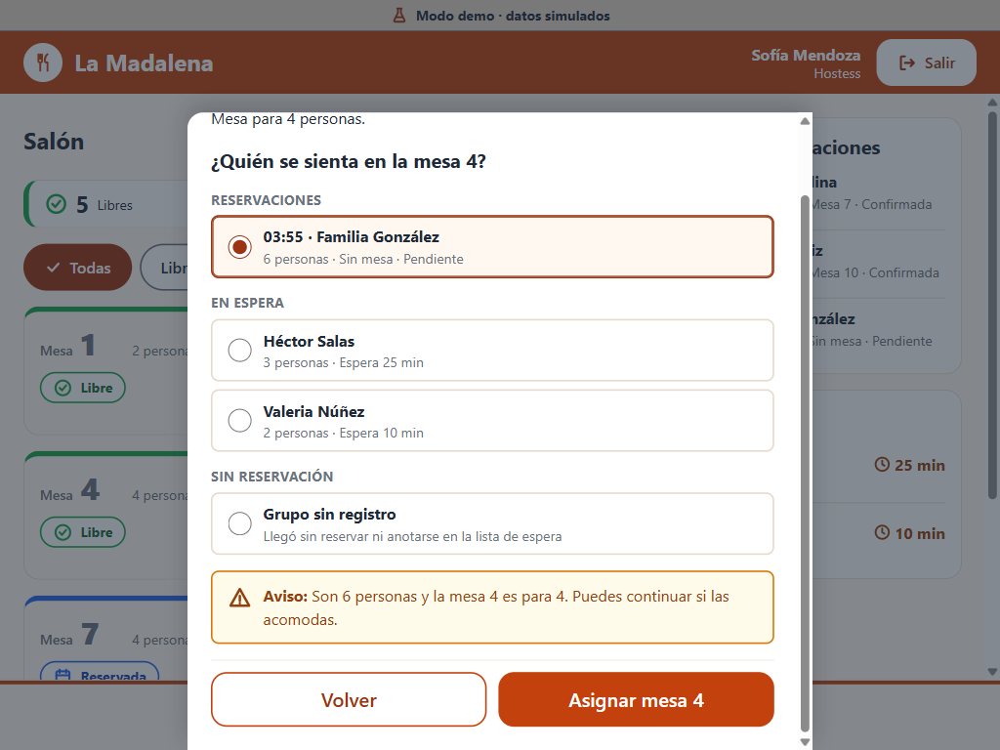
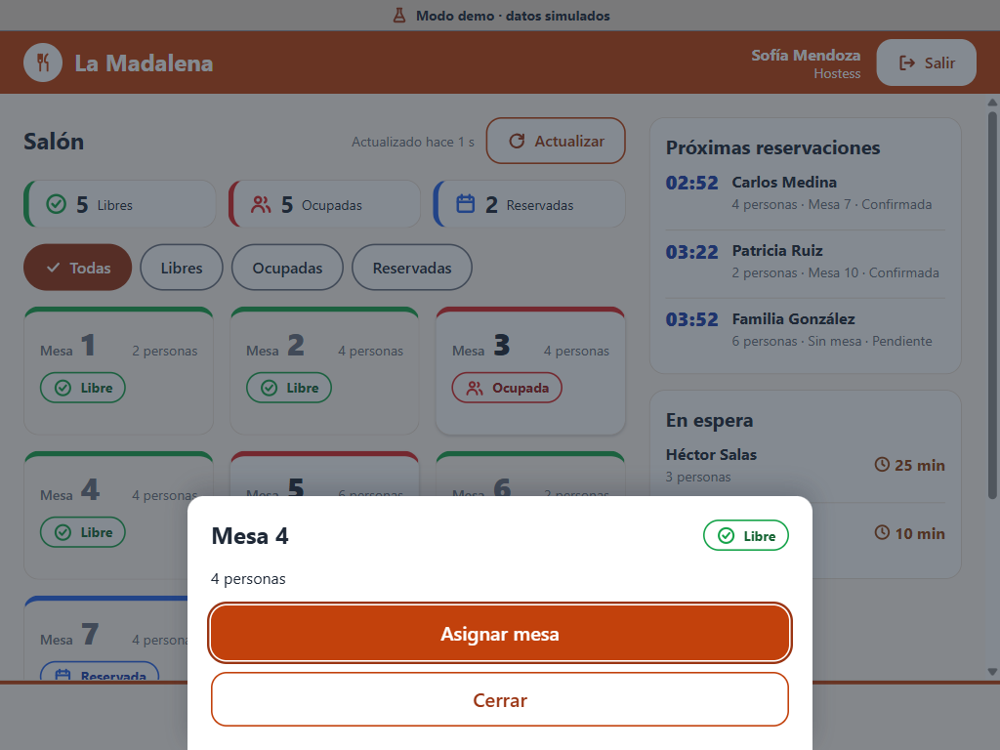
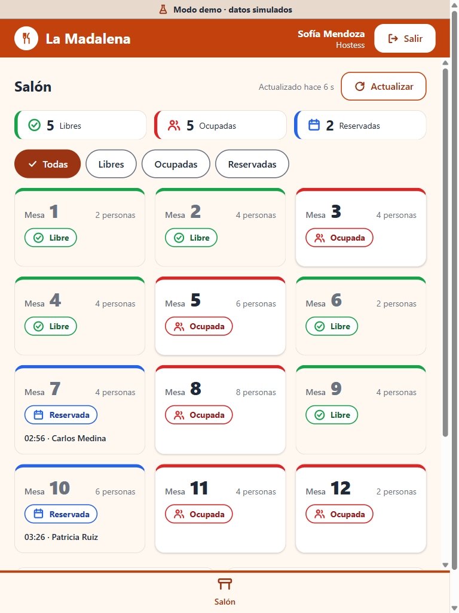
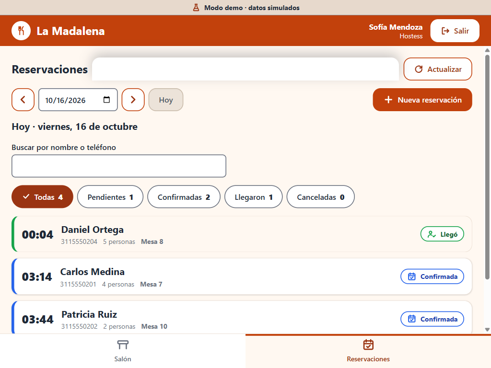
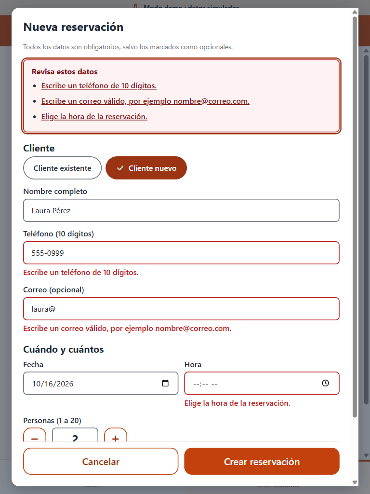
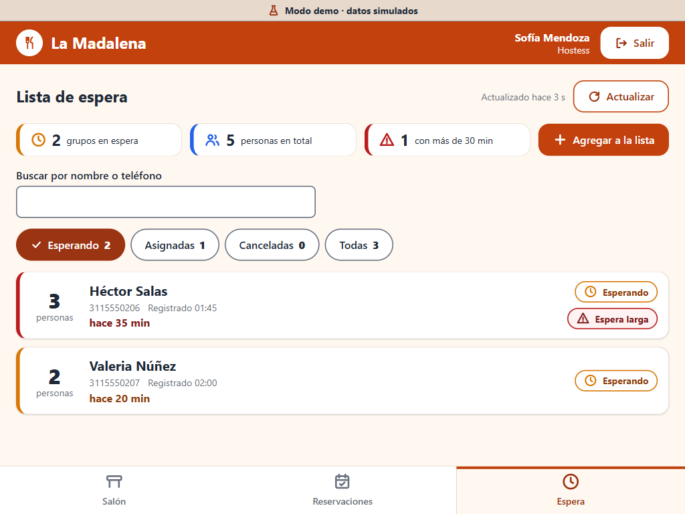
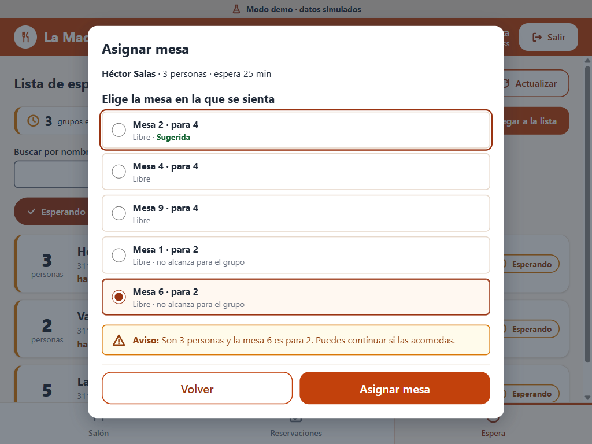
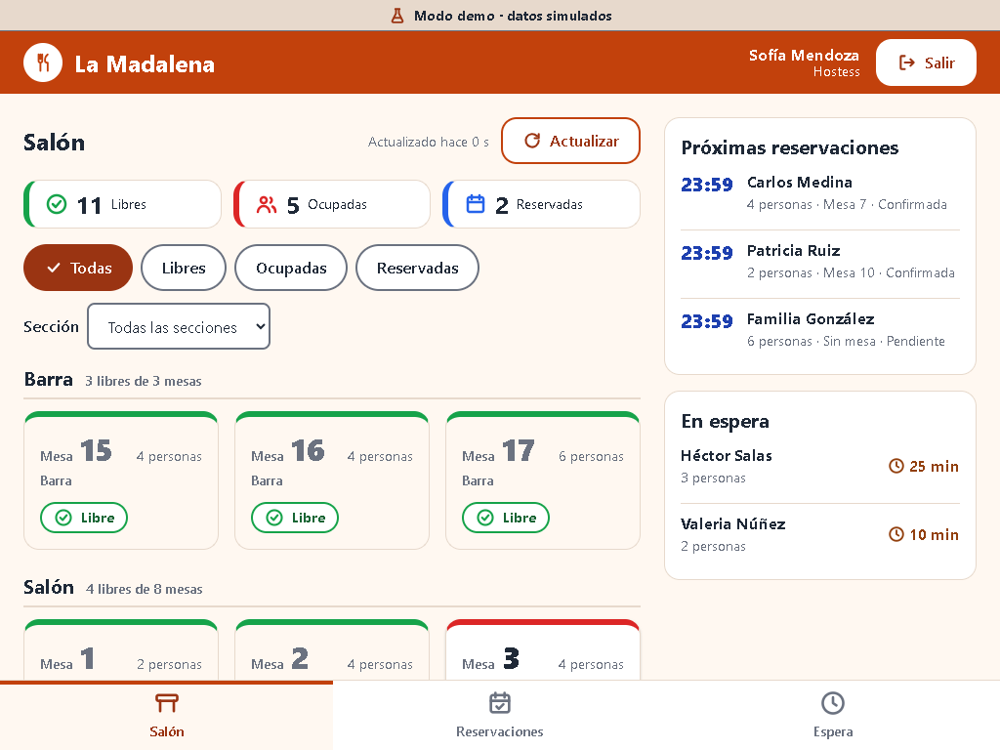
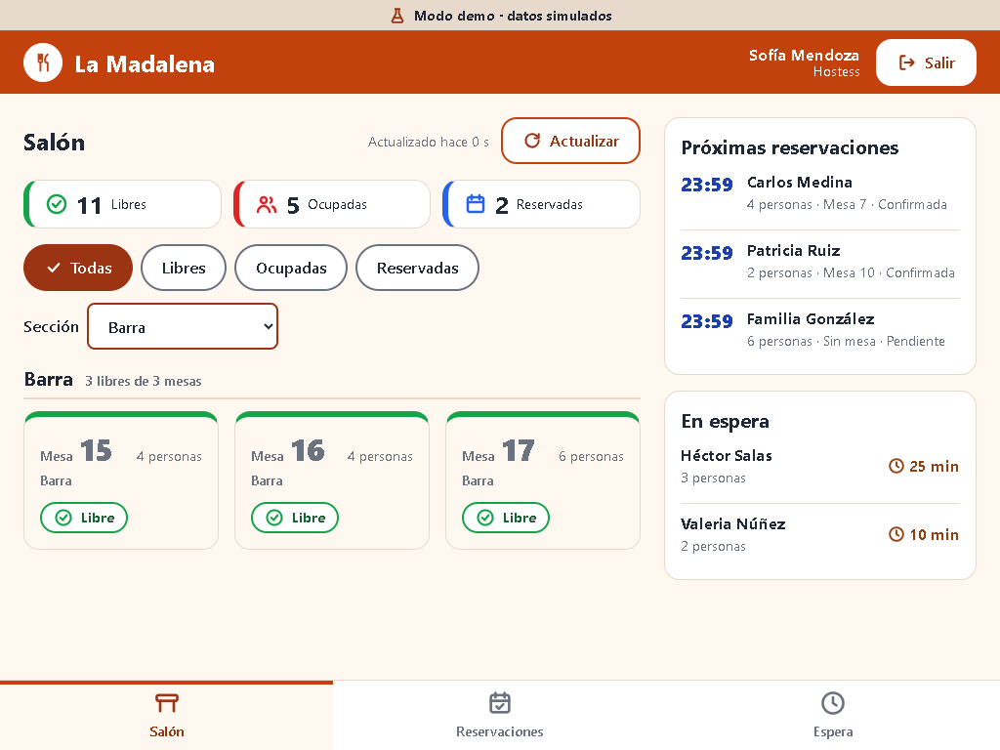

# Pantallas del rol hostess

Interfaz de "La Madalena" para tablet (base 1024×768 horizontal; también 768×1024). Hay tres pantallas:
**Salón** (H1), **Reservaciones** (H2) y **Espera** (H3). Las capturas están en
[`capturas/`](capturas/) y se tomaron con el servidor de desarrollo en modo mock (`VITE_USE_MOCK=true`, usuario
`hostess` / `1234`). El contrato de API que necesita está en [`contrato-api-hostess.md`](contrato-api-hostess.md).

> La columna «Qué cubre» describe la función; no pongo número de caso de uso (CU) porque no tengo el catálogo de CU del
> rol hostess. Conviene añadirlo cuando se confirme.

| # | Pantalla | Ruta | Qué cubre | Captura |
|---|---|---|---|---|
| 1 | Salón (1024×768) | `/hostess/salon` | Estado de las mesas (Libres, Ocupadas, Reservadas), filtros, próximas reservaciones y lista de espera a un lado. Solo lectura | [h1-01-salon-1024x768](capturas/h1-01-salon-1024x768.png) |
| 2 | Hoja de acciones de una mesa | _(diálogo del Salón)_ | Estado y capacidad de la mesa; «Asignar mesa» (en una mesa ocupada queda con `aria-disabled` y explica el motivo) | [h1-02-hoja-acciones-1024x768](capturas/h1-02-hoja-acciones-1024x768.png) |
| 3 | Asignar mesa | _(segundo paso del mismo diálogo)_ | Elegir el grupo (reservación, lista de espera o grupo sin registro), aviso de capacidad que no bloquea y confirmar | [h1-03-asignar-mesa-1024x768](capturas/h1-03-asignar-mesa-1024x768.png) |
| 4 | Mesa asignada | `/hostess/salon` | Resultado: la mesa pasa a Ocupada, el grupo sale de las listas y se anuncia «Mesa 4 asignada a Familia González» | [h1-04-mesa-asignada-1024x768](capturas/h1-04-mesa-asignada-1024x768.png) |
| 5 | Salón (768×1024) | `/hostess/salon` | Igual que la 1, con las reservaciones y la espera **debajo** de las mesas | [h1-05-salon-768x1024](capturas/h1-05-salon-768x1024.png) · [panel inferior](capturas/h1-06-panel-inferior-768x1024.png) |
| 5a | Salón agrupado por sección | `/hostess/salon` | **RF-MES-007**: un grupo por sección con encabezado «Barra · 3 libres de 3 mesas» y la sección en cada tarjeta | [h1-07-salon-secciones-1024x768](capturas/h1-07-salon-secciones-1024x768.png) · [768×1024](capturas/h1-10-salon-secciones-768x1024.png) · [zoom 200 %](capturas/h1-11-salon-zoom-200.png) |
| 5b | Salón filtrado por sección | `/hostess/salon?seccion=Barra` | Select «Sección» combinable con los chips de estado; el resumen sigue contando todas las mesas | [h1-08-salon-filtro-barra-1024x768](capturas/h1-08-salon-filtro-barra-1024x768.png) |
| 5c | Hoja de acciones con sección | _(diálogo del Salón)_ | «Sección: Terraza» bajo el título de la mesa | [h1-09-hoja-acciones-seccion-1024x768](capturas/h1-09-hoja-acciones-seccion-1024x768.png) |

### Reservaciones (H2)

| # | Pantalla | Ruta | Qué cubre | Captura |
|---|---|---|---|---|
| 6 | Reservaciones (1024×768) | `/hostess/reservaciones` | Lista del día (hoy por defecto, con selector de día), filtros por estado —incluida Vencida— con su cantidad y búsqueda por nombre o teléfono. Cada reservación: hora, cliente, teléfono, personas, mesa o «Sin mesa» y estado (ícono + texto) | [h2-01-reservaciones-1024x768](capturas/h2-01-reservaciones-1024x768.png) |
| 7 | Hoja de una reservación | _(diálogo de Reservaciones)_ | Datos y acciones según el estado: Registrar llegada, Confirmar, Editar y Cancelar (los estados finales solo se pueden cerrar) | [h2-02-hoja-reservacion-1024x768](capturas/h2-02-hoja-reservacion-1024x768.png) |
| 8 | Nueva reservación con errores | _(diálogo de Reservaciones)_ | Validación: resumen de errores enfocable con enlaces a cada campo y un error bajo cada campo | [h2-03-nueva-reservacion-errores-1024x768](capturas/h2-03-nueva-reservacion-errores-1024x768.png) |
| 9 | Nueva reservación: cliente existente | _(mismo diálogo)_ | Búsqueda de cliente por nombre o teléfono y cliente ya elegido | [h2-04-nueva-reservacion-cliente-elegido-1024x768](capturas/h2-04-nueva-reservacion-cliente-elegido-1024x768.png) |
| 10 | Registrar llegada | _(mismo diálogo)_ | Si la reservación no tiene mesa, se elige entre las libres (con aviso de capacidad que no bloquea) | [h2-05-registrar-llegada-1024x768](capturas/h2-05-registrar-llegada-1024x768.png) |
| 11 | Cancelar reservación | _(mismo diálogo)_ | Confirmación de una acción destructiva; avisa que la mesa se libera | [h2-06-cancelar-reservacion-1024x768](capturas/h2-06-cancelar-reservacion-1024x768.png) |
| 12 | Reservaciones (768×1024) | `/hostess/reservaciones` | Igual que la 6, con el estado debajo del nombre | [h2-07-reservaciones-768x1024](capturas/h2-07-reservaciones-768x1024.png) |
| 13 | Cliente nuevo con errores (768×1024) | _(diálogo de Reservaciones)_ | Alta de cliente (nombre, teléfono y correo obligatorio para reservar) con varios errores a la vez | [h2-08-cliente-nuevo-errores-768x1024](capturas/h2-08-cliente-nuevo-errores-768x1024.png) |

### Lista de espera (H3)

| # | Pantalla | Ruta | Qué cubre | Captura |
|---|---|---|---|---|
| 14 | Espera (1024×768) | `/hostess/espera` | Grupos que esperan, el que lleva más tiempo arriba: personas, nombre, teléfono, hora de registro y «hace 25 min». Contadores (grupos, personas, con espera larga), filtro por estado, búsqueda y marca «Espera larga» (ícono + texto) pasados 30 min | [h3-01-espera-1024x768](capturas/h3-01-espera-1024x768.png) |
| 15 | Agregar a la lista | _(diálogo de Espera)_ | Cliente (existente o nuevo, el mismo selector de Reservaciones) y personas (1 a 20), con resumen de errores y error bajo cada campo | [h3-02-agregar-errores-1024x768](capturas/h3-02-agregar-errores-1024x768.png) |
| 16 | Asignar mesa a un grupo | _(diálogo de Espera)_ | Mesas libres sugeridas (la mejor, marcada «Sugerida»; las que no alcanzan, al final y con aviso que no bloquea) | [h3-03-asignar-mesa-1024x768](capturas/h3-03-asignar-mesa-1024x768.png) |
| 17 | Quitar de la lista | _(diálogo de Espera)_ | Confirmación; el grupo pasa a «cancelada» (no se borra) | [h3-04-quitar-de-la-lista-1024x768](capturas/h3-04-quitar-de-la-lista-1024x768.png) |
| 18 | Espera, todos los estados | `/hostess/espera?estado=todas` | Esperando, asignadas y canceladas juntas; las que ya no esperan van atenuadas | [h3-05-espera-todas-1024x768](capturas/h3-05-espera-todas-1024x768.png) |
| 19 | Espera (768×1024) | `/hostess/espera` | Igual que la 14, con las marcas debajo del nombre | [h3-06-espera-768x1024](capturas/h3-06-espera-768x1024.png) |

## Vista previa

| Salón | Asignar mesa |
|---|---|
|  |  |

| Hoja de acciones | Tablet vertical |
|---|---|
|  |  |

| Reservaciones | Nueva reservación (errores) |
|---|---|
|  |  |

| Espera | Asignar mesa a un grupo |
|---|---|
|  |  |

| Salón por sección | Filtro por sección |
|---|---|
|  |  |

## Secciones del salón (RF-MES-007)

Mismo comportamiento que el Panel del mesero (ver [`pantallas-mesero.md`](pantallas-mesero.md)):

1. Se agrupa solo si hay **más de una sección** (contando «Sin sección»); con una sola o ninguna, el Salón se ve como antes.
2. Secciones en orden alfabético, «Sin sección» al final y mesas por número. Encabezado `h3` por grupo con
   «N libres de M mesas» (de toda la sección, aunque haya filtro de estado); cada grupo es una región con `aria-labelledby`.
3. Select «Sección» junto a los chips (con 1024×768 baja a su propia línea porque el panel lateral ocupa espacio), en la
   URL como `?seccion=Barra` o `?seccion=sin-seccion`. Al cambiar un filtro se anuncia el resultado (`aria-live`).
4. La tarjeta muestra la sección en texto pequeño; la hoja de acciones, «Sección: …».
5. La sección sale de `GET /api/mesas` (`zona`). La respuesta de «Asignar mesa» no la trae, pero el Salón recarga todas
   las mesas después de asignar, así que no se pierde.

## Cómo funciona la lista de espera

1. **Lista:** `/hostess/espera` muestra por defecto a quienes **esperan**, el que lleva más tiempo, arriba. El filtro
   (`?estado=asignada|cancelada|todas`) y la búsqueda por nombre o teléfono no cambian los datos. «hace 25 min» avanza
   solo con el reloj de la pantalla (cada 30 s) y con cada actualización.
2. **Espera larga:** al llegar a **30 minutos** el grupo lleva la marca «Espera larga» (ícono + texto) y su borde pasa a
   rojo; el contador de arriba dice cuántos hay. El umbral es la constante `UMBRAL_ESPERA_LARGA_MIN` en `utils/espera.ts`.
3. **Agregar:** cliente existente (búsqueda) o nuevo (nombre y teléfono de 10 dígitos, correo opcional) y personas de 1 a 20.
   Un cliente que ya está esperando no se puede anotar dos veces.
4. **Asignar mesa:** se muestran las mesas **libres**, primero las que alcanzan (la más justa, «Sugerida»). Si el grupo no cabe
   se avisa, sin bloquear. La mesa pasa a **ocupada** y el grupo a **asignada**. Es el mismo efecto que «Asignar mesa» del Salón.
5. **Quitar de la lista:** pide confirmación; el grupo pasa a **cancelada** (se fue). La fila no se borra.
6. El **Salón** refleja todo: el panel «En espera» y las mesas libres/ocupadas se actualizan.

## Cómo funciona Reservaciones

1. **Lista:** `/hostess/reservaciones` muestra hoy; las flechas, el campo de fecha y «Hoy» cambian de día. La lista se
   actualiza sola cada pocos segundos. El filtro (`?estado=`) y la búsqueda no cambian el día.
2. **Nueva reservación:** cliente (buscar uno existente por nombre o teléfono, o crear uno con nombre, teléfono de
   10 dígitos y correo obligatorio), fecha y hora (no pasadas), personas (1 a 20), preferencias opcionales de sección y
   accesibilidad, y mesa opcional. Si el cliente ya existe sin correo válido, se puede completar o corregir el correo
   desde el selector. La mesa solo se ofrece para reservaciones **de hoy** y solo entre las **libres**; las sugerencias
   priorizan sección, planta baja, espacio para carriola, acceso sin escaleras y capacidad. Si las personas no caben se
   avisa, sin bloquear. Al guardar la lista va al día de la reservación y la resalta.
3. **Editar:** solo `pendiente` o `confirmada`; el cliente no cambia. Se puede cambiar fecha, hora, personas y mesa.
4. **Confirmar:** `pendiente → confirmada`.
5. **Cancelar:** pide confirmación. La reservación pierde su mesa y, si nadie más la necesita, la mesa vuelve a **libre**.
   Si la reservación permanece pendiente o confirmada más allá de la tolerancia configurada por Gerencia, pasa a
   **Vencida**, la mesa se libera y se encola un aviso por correo.
6. **Registrar llegada:** la reservación pasa a `llego` (con `llegada_en`) y la mesa queda **ocupada**. Si no tiene mesa
   (o la suya ya no está disponible) se elige una. Es el mismo efecto que «Asignar mesa» del Salón.
7. El **Salón** refleja todo: mesas reservadas con hora y nombre, mesas liberadas o llenas y la lista de próximas
   reservaciones.

La tolerancia de llegada y la anticipación de los recordatorios se configuran desde **Gerente → Reservas**. El backend
envía las notificaciones con Resend; los fallos quedan registrados en la cola para reintento. La API requiere la
migración `010_reservaciones_y_caracteristicas.sql` y `RESEND_API_KEY`/`RESEND_FROM` en el entorno del backend. Consulta
[resend-reservaciones.md](resend-reservaciones.md).

## Cómo funciona «Asignar mesa»

1. Se toca una mesa **libre o reservada** → hoja de acciones → **Asignar mesa**. Una mesa **ocupada** no se asigna.
2. Se elige a quién se sienta: una **reservación** `pendiente` o `confirmada` (sin mesa, o con esa misma mesa), un grupo
   **en espera**, o un **grupo sin registro** (se escribe cuántas personas son). Si la mesa está reservada, su
   reservación llega ya elegida.
3. Avisos que **no bloquean**: el grupo es más grande que la mesa; la mesa está reservada para otro grupo.
4. **Asignar mesa N**: la mesa pasa a `ocupada`; una reservación pasa a `llego` y se llena `llegada_en`; un grupo en espera
   pasa a `asignada`. La petición lleva `Idempotency-Key`: si se pierde la respuesta, reintentar no duplica nada.

## Accesibilidad y uso táctil

- Objetivos táctiles de **48 px o más** (tarjetas, chips, botones, filas de grupo de 56 px, botones − / + de personas).
- **Foco visible** en todo; la hoja atrapa el foco, Escape la cierra y el foco vuelve a la tarjeta de origen. Al pasar de
  paso, el foco va al título de la hoja.
- **Sin depender del color**: cada estado lleva ícono y texto («Libre», «Ocupada», «Reservada»); el grupo elegido lleva
  borde grueso **y** el punto del radio; los avisos llevan ícono y la palabra «Aviso:».
- **aria-live**: la región de avisos de capacidad es `role="status"`; los errores son `role="alert"`; «Mesa N asignada a …»
  se anuncia en la región del layout sin quitar el foco.
- **Teclado completo**: los grupos son un grupo de radios nativo (flechas), «Volver» y «Asignar mesa» son botones.
- `prefers-reduced-motion`: sin animaciones ni transiciones (reglas globales de `base.css` y locales).
- Sin scroll horizontal en 1024×768 ni en 768×1024; los botones de la hoja quedan fijos al pie para que «Asignar mesa»
  siempre esté a la vista. Con secciones también se revisó con zoom de 200 % (sin scroll horizontal).
- **Campos de fecha:** el ícono del calendario nativo (Chrome y Edge) lleva el mismo anillo de foco que el resto de la app
  (`::-webkit-calendar-picker-indicator:focus-visible` en `base.css`).
