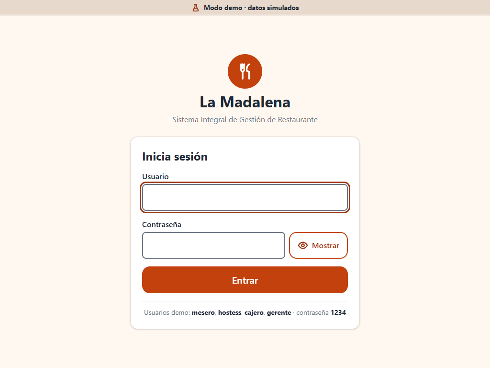
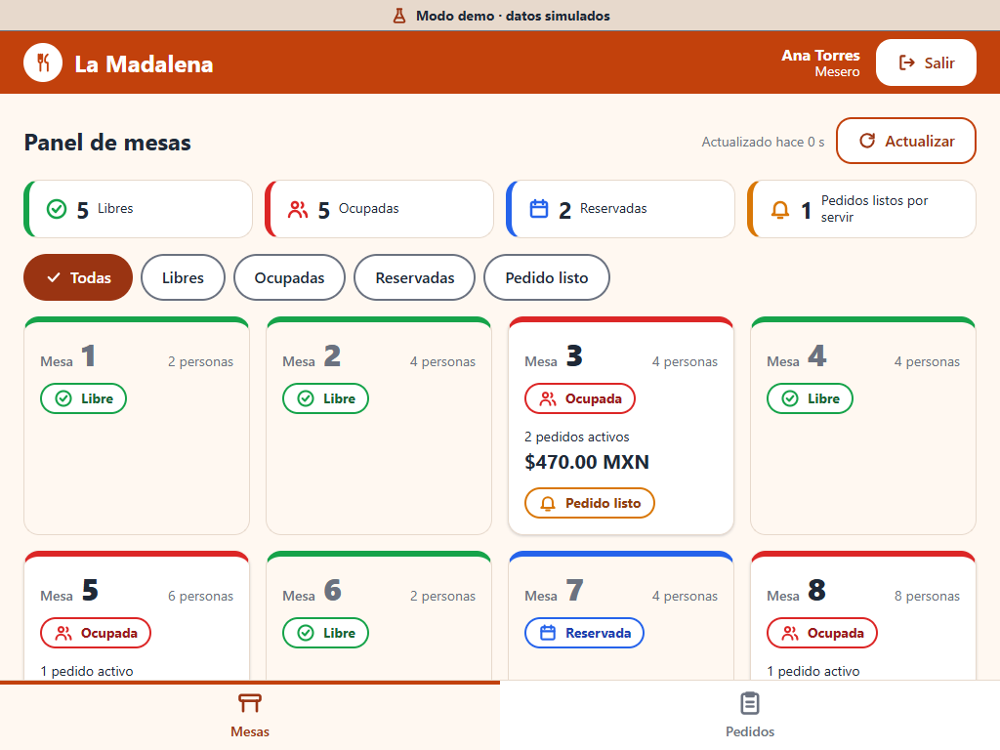
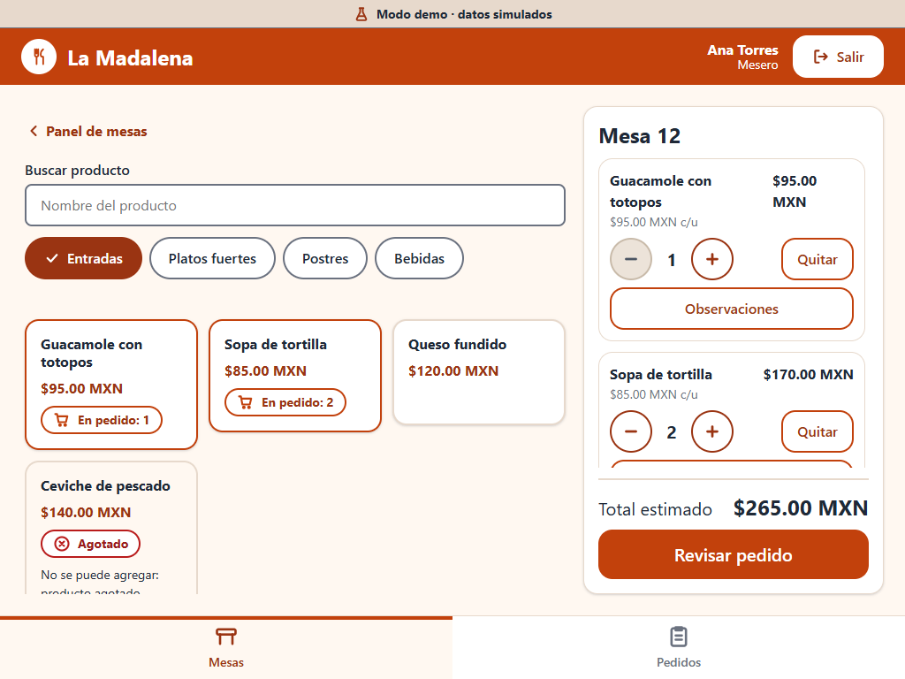
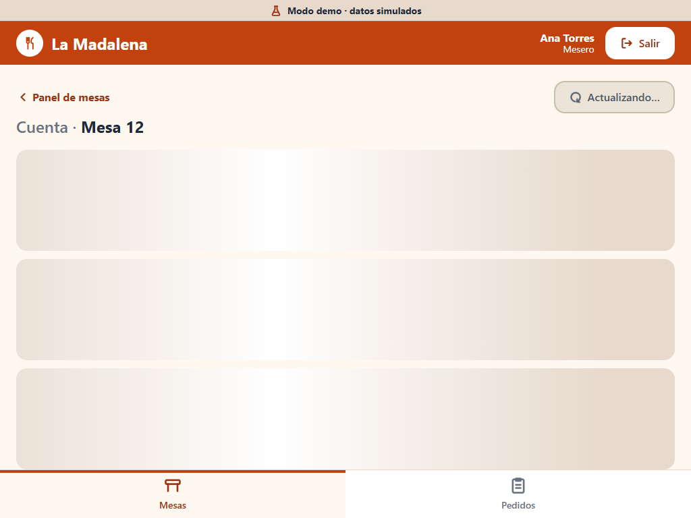
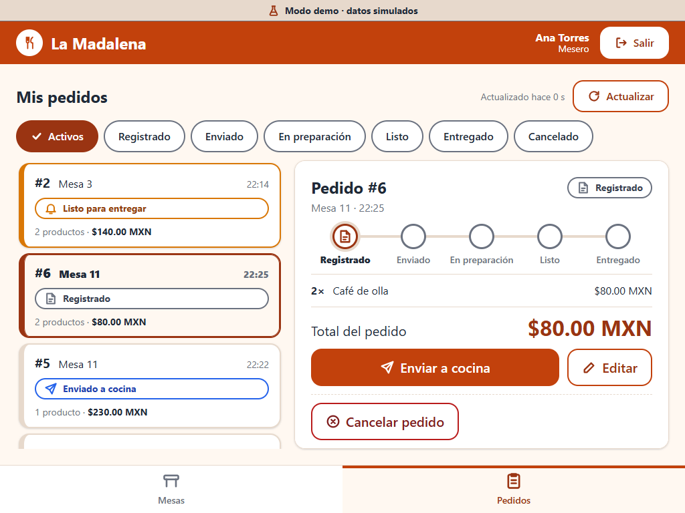
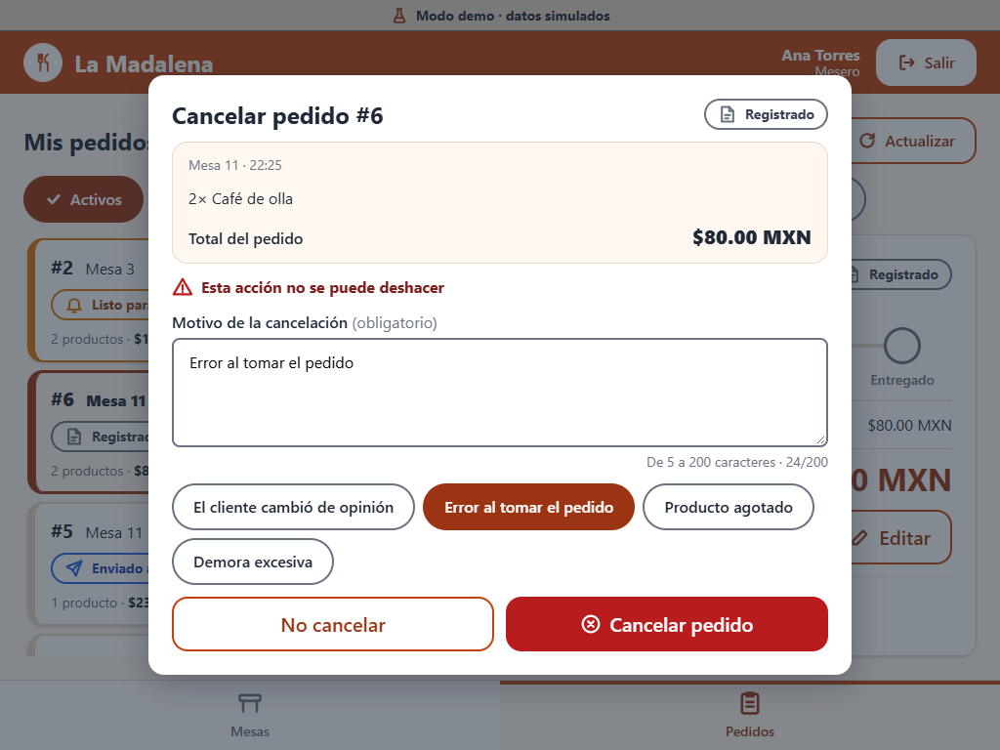
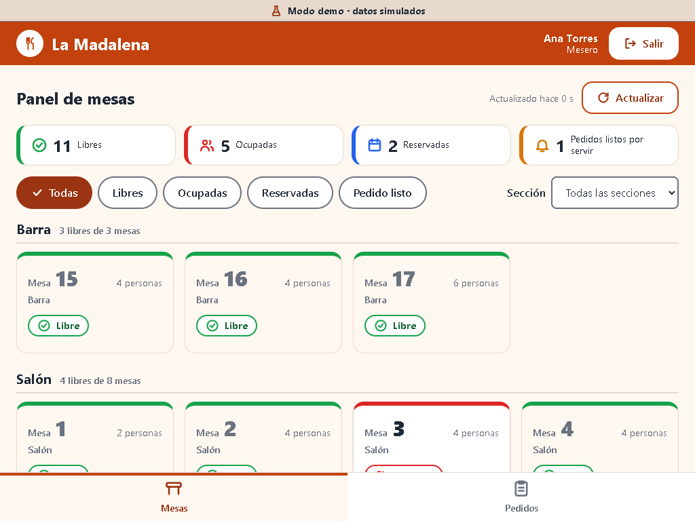
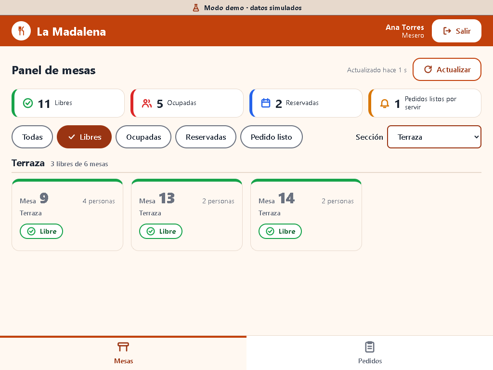

# Pantallas del rol mesero

Interfaz de "La Madalena" para tablet (base 1024×768 horizontal; también 768×1024). Cada pantalla
se relaciona con el caso de uso (CU) del sistema que cubre. Las capturas están en
[`capturas/`](capturas/) y se generan con Chrome headless contra el servidor de desarrollo.

| # | Pantalla | Ruta | Caso de uso que cubre | Captura |
|---|---|---|---|---|
| 1 | Inicio de sesión | `/login` | **CU1** Iniciar sesión | [01-login-1024x768](capturas/01-login-1024x768.png) |
| 2 | Panel de mesas | `/mesero/mesas` | **CU6** Consultar cuentas de mesa (estado, pedidos activos y total de la cuenta de cada mesa); avisa de pedidos listos | [02-panel-mesas-1024x768](capturas/02-panel-mesas-1024x768.png) · [02b (768×1024)](capturas/02b-panel-mesas-768x1024.png) |
| 3 | Panel de mesas con filtro | `/mesero/mesas?estado=ocupada` | **CU6** (filtros Todas, Libres, Ocupadas, Reservadas y Pedido listo) | [03-panel-mesas-filtro-ocupadas-1024x768](capturas/03-panel-mesas-filtro-ocupadas-1024x768.png) |
| 4 | Hoja de acciones de una mesa | _(diálogo del panel)_ | **CU6** (Ver cuenta) y acceso a **CU7** (Nuevo pedido) y **CU15** (Pedidos de la mesa) | [04-hoja-acciones-mesa-1024x768](capturas/04-hoja-acciones-mesa-1024x768.png) |
| 5 | Pedido de mesa (1024×768) | `/mesero/mesas/:idMesa/pedido` | **CU9** Consultar menú · **CU7** Registrar pedidos (también edita un pedido registrado: `?editar=:idPedido`) | [05-pedido-mesa-1024x768](capturas/05-pedido-mesa-1024x768.png) |
| 6 | Pedido de mesa (768×1024) | `/mesero/mesas/:idMesa/pedido` | **CU9** · **CU7** (el pedido pasa a una barra inferior con "Ver pedido") | [06-pedido-mesa-768x1024](capturas/06-pedido-mesa-768x1024.png) |
| 7 | Revisión del pedido | _(diálogo de Pedido de mesa)_ | **CU20** Verificar disponibilidad · **CU7** Registrar · **CU10** Enviar pedido a cocina | [07-revision-pedido-1024x768](capturas/07-revision-pedido-1024x768.png) |
| 8 | Cuenta de mesa | `/mesero/mesas/:idMesa/cuenta` | **CU6** Consultar cuentas de mesa (pedidos de la cuenta, cancelados que no suman y total) | [08-cuenta-mesa-1024x768](capturas/08-cuenta-mesa-1024x768.png) |
| 9 | Solicitar cuenta | _(diálogo de Cuenta de mesa)_ | **CU6** (el mesero solo solicita la cuenta y elige pago físico o digital; el cobro es de caja) | [09-solicitar-cuenta-1024x768](capturas/09-solicitar-cuenta-1024x768.png) |
| 10 | Mis pedidos: lista y detalle (1024×768) | `/mesero/pedidos` y `/mesero/pedidos/:idPedido` | **CU15** Consultar pedidos · **CU10** Enviar pedido a cocina (acción del detalle de un pedido registrado) | [10-mis-pedidos-lista-y-detalle-1024x768](capturas/10-mis-pedidos-lista-y-detalle-1024x768.png) |
| 11 | Mis pedidos: lista (768×1024) | `/mesero/pedidos` | **CU15** | [11-mis-pedidos-lista-768x1024](capturas/11-mis-pedidos-lista-768x1024.png) |
| 12 | Mis pedidos: detalle (768×1024) | `/mesero/pedidos/:idPedido` | **CU15** · **CU10** (pantalla aparte con "Volver a pedidos") | [12-mis-pedidos-detalle-768x1024](capturas/12-mis-pedidos-detalle-768x1024.png) |
| 13 | Cancelar pedido | _(diálogo de Mis pedidos y de Cuenta de mesa)_ | **CU8** Cancelar pedidos (motivo obligatorio; en preparación requiere al gerente) | [13-cancelar-pedido-1024x768](capturas/13-cancelar-pedido-1024x768.png) |
| 14 | Panel agrupado por sección | `/mesero/mesas` | **CU6** · **RF-MES-007**: un grupo por sección con encabezado «Terraza · 3 libres de 6 mesas»; la sección también en cada tarjeta | [14-panel-mesas-secciones-1024x768](capturas/14-panel-mesas-secciones-1024x768.png) · [18 (768×1024)](capturas/18-panel-mesas-secciones-768x1024.png) |
| 15 | Filtro de estado + sección | `/mesero/mesas?estado=libre&seccion=Terraza` | **RF-MES-007**: el select «Sección» se combina con los chips; el resumen sigue contando todas las mesas | [15-panel-mesas-filtro-libres-terraza-1024x768](capturas/15-panel-mesas-filtro-libres-terraza-1024x768.png) |
| 16 | Sin resultados con sección | `/mesero/mesas?estado=ocupada&seccion=sin-seccion` | «No hay mesas ocupadas sin sección» y «Ver todas las mesas» (quita los dos filtros) | [16-panel-mesas-vacio-con-seccion-1024x768](capturas/16-panel-mesas-vacio-con-seccion-1024x768.png) |
| 17 | Hoja de acciones con sección | _(diálogo del panel)_ | «Sección: Terraza» bajo el título de la mesa | [17-hoja-acciones-seccion-1024x768](capturas/17-hoja-acciones-seccion-1024x768.png) |
| 18 | Panel con zoom 200 % | `/mesero/mesas` | Ventana de 1024×768 al 200 % (512×384 px CSS): sin scroll horizontal; el select baja de línea | [19-panel-mesas-zoom-200-filtros](capturas/19-panel-mesas-zoom-200-filtros.png) · [grupos](capturas/19b-panel-mesas-zoom-200-grupos.png) |
| 19 | Panel con una sola sección | `/mesero/mesas` | Todas las mesas en la misma sección: sin encabezados, sin select y sin la sección en la tarjeta (igual que antes) | [20-panel-mesas-una-seccion-1024x768](capturas/20-panel-mesas-una-seccion-1024x768.png) |
| 20 | Pedidos del salón al cambiar de pedido | `/mesero/pedidos/:idPedido` | El detalle vuelve arriba al elegir otro pedido (antes se quedaba a media altura) | [21-pedidos-detalle-arriba-al-cambiar-1024x640](capturas/21-pedidos-detalle-arriba-al-cambiar-1024x640.png) |

## Vista previa

| Login | Panel de mesas |
|---|---|
|  |  |

| Pedido de mesa | Cuenta de mesa |
|---|---|
|  |  |

| Mis pedidos | Cancelar pedido |
|---|---|
|  |  |

| Panel por sección | Filtro libres + Terraza |
|---|---|
|  |  |

## Secciones del salón en el Panel (RF-MES-007)

1. **Cuándo se agrupa:** solo si las mesas tienen **más de una sección** (contando «Sin sección»). Si todas tienen la misma
   o ninguna, el panel se ve como antes: una sola cuadrícula, sin encabezados, sin select y sin la sección en las tarjetas.
2. **Orden:** secciones en orden alfabético (sin distinguir mayúsculas ni acentos) y «Sin sección» al final; dentro de cada
   grupo, las mesas por número. Una sección vacía, solo con espacios o `null` cuenta como «Sin sección».
3. **Encabezado de cada grupo:** `h3` (el título de la pantalla es `h2`) con el nombre y «N libres de M mesas». Los números
   son de **toda** la sección, aunque haya un filtro de estado. Cada grupo es una región (`section` con `aria-labelledby`).
4. **Filtro «Sección»:** select junto a los chips de estado; se combina con ellos y queda en la URL:
   `?seccion=Terraza` o `?seccion=sin-seccion`. Una sección que ya no existe en la URL se ignora (se ven todas). Los
   contadores del resumen (Libres, Ocupadas…) siguen siendo del total de mesas.
5. **Anuncio:** al cambiar un filtro, una región `aria-live` dice el resultado sin mover el foco, p. ej.
   «Filtro: libres, sección Terraza. 3 mesas.». La actualización automática no lo repite.
6. **Tarjeta y hoja de acciones:** la tarjeta muestra la sección en texto pequeño (con varias secciones); la hoja de
   acciones muestra «Sección: …» siempre que la mesa tenga una.
7. **Orden de Tab:** Actualizar → chips de estado → Sección → tarjetas, grupo por grupo.

## Notas

- La franja superior "Modo demo · datos simulados" aparece mientras se usa el mock
  (`VITE_USE_MOCK=true`) y desaparece con la API real (`npm run build:api`).
- Las pantallas de gerente, cocina, caja y hostess **no** forman parte de esta aplicación.
  Donde el mesero depende de ellas (autorizar una cancelación en preparación, cobrar la cuenta) la
  interfaz solo lo indica con texto.
- Las capturas se tomaron con Chrome headless (Playwright, fuera del proyecto: no es una dependencia)
  contra `npm run dev`, con el usuario `mesero`. Si cambia el diseño, hay que volver a tomarlas a mano
  (o con cualquier herramienta de capturas) a 1024×768 y 768×1024 y conservar los nombres.
- Las capturas 14 a 21 (secciones y arreglo del detalle) se tomaron con Chrome headless manejado por el protocolo DevTools
  desde un script de Node fuera del proyecto, contra `npm run dev:demo`. El zoom de 200 % se simula con una ventana de
  512×384 px CSS y escala 2. La 20 se tomó cambiando en el mock todas las mesas a la sección «Salón».
- El mock trae secciones de ejemplo: Salón (mesas 1 a 8), Terraza (9 a 14), Barra (15 a 17) y la 18 sin sección.

> **Los datos de las capturas son simulados.** Proceden del mock del frontend (mesas, productos,
> pedidos, montos y horas de ejemplo); no hay ninguna conexión con la API ni con la base de datos reales.
